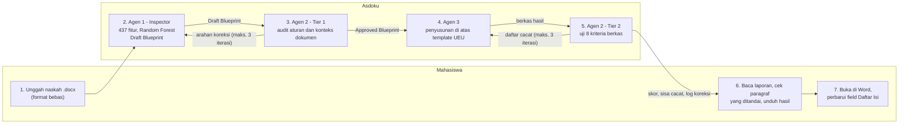

# BUSINESS REQUIREMENTS DOCUMENT (BRD)
## Asdoku — Multi-Agent System Berbasis Natural Language Processing untuk Otomatisasi Deteksi Struktur dan Formatting Dokumen Tugas Akhir

---

## 1. Executive Summary

### 1.1 Latar belakang

Naskah tugas akhir di Universitas Esa Unggul wajib mengikuti Pedoman Penulisan Tugas Akhir (SK Rektor No. 5 Tahun 2018), yang mengatur kertas dan margin, huruf, penomoran bab dan sub-bab, penomoran halaman bagian awal dan bagian isi, judul tabel dan gambar, serta daftar referensi. Format yang seragam memudahkan pembimbing dan penguji membaca naskah dan memungkinkan pengarsipan yang seragam.

### 1.2 Masalah

1. **Naskah tidak memakai *Heading Styles*.** Judul bab dan sub-bab hanya ditebalkan manual, sehingga *Navigation Pane* kosong dan Daftar Isi harus diketik sendiri.
2. **Penomoran diketik manual.** Nomor sub-bab, nomor *caption*, serta nomor halaman Romawi dan Arab rusak setiap kali naskah direvisi.
3. **Pemeriksaan format masih manual.** Mahasiswa dan dosen pembimbing memeriksa secara visual, dan pelanggaran masih lolos. Putra et al. (2026) menemukan pelanggaran pada 15,9% pasangan dokumen–aturan di 17 skripsi yang sudah disetujui.
4. **Alat yang ada tidak memperbaiki.** Template Word hanya membantu bila dipakai sejak awal; pemeriksa format yang ada berhenti pada pelaporan kesalahan.
5. **Satu model saja rentan salah.** Arti sebuah paragraf sering bergantung pada konteks dokumen (misalnya uraian “BAB II …” di sub-bab Sistematika Penulisan bukan judul bab baru).
6. **Belum ada korpus berlabel.** Belum tersedia korpus naskah tugas akhir berbahasa Indonesia dengan label struktur yang diverifikasi manusia.

Kuesioner studi pendahuluan kepada 35 mahasiswa Fakultas Ilmu Komputer UEU (November 2026; 82,9% Teknik Informatika, 74,3% sedang menyusun proposal) menguatkan masalah tersebut:

| Temuan | Responden |
| :--- | :---: |
| Pernah menerima revisi format dari dosen pembimbing atau penguji | 62,9% |
| Format kadang-kadang, sering, atau selalu berantakan lagi setelah isi direvisi | 60,0% |
| Menghabiskan lebih dari 3 jam khusus untuk merapikan format | 40,0% |
| Setuju atau sangat setuju bahwa merapikan format mengurangi waktu mengerjakan isi | 54,3% |
| Masalah format muncul di halaman awal / di isi bab | 85,7% / 85,7% |
| Masalah format muncul di daftar isi, daftar tabel, daftar gambar | 60,0% |
| Mengetahui dan memakai daftar isi serta nomor bab otomatis | 80,0% |
| Mungkin atau sangat mungkin memakai aplikasi perapi format otomatis | 82,9% |

Hal yang paling banyak menyulitkan adalah margin atau ukuran kertas (62,9%), huruf dan spasi (51,4%), nomor halaman Romawi/Arab (34,3%), dan format yang berubah setelah salin-tempel (34,3%). Kekhawatiran terbesar terhadap aplikasi semacam ini adalah sitasi Mendeley/Zotero rusak (40,0%), isi tulisan berubah atau hilang (37,1%), dan privasi naskah (34,3%); ketiganya dijawab NFR-01 dan NFR-04. Catatan: sebagian besar responden masih pada tahap proposal, dan angka 80,0% yang mengaku memakai fitur otomatis Word adalah penilaian diri. Pemeriksaan langsung terhadap enam naskah tugas akhir korpus menunjukkan nomor sub-bab diketik manual pada empat dari enam naskah tugas akhir (221 dari 453 judul sub-bab, 48,8%), margin berbeda dari pedoman pada tiga naskah (satu masih memakai margin bawaan Word 2,54 cm), header “Universitas Esa Unggul” tidak ada pada tiga naskah, dan tabel bergaris vertikal ada pada tiga naskah.

### 1.3 Solusi yang diusulkan

Asdoku (Asisten Dokumenku) adalah aplikasi web yang menerima naskah .docx berformat bebas dan menghasilkan naskah yang sesuai pedoman tanpa mengubah isinya. Sistem terdiri atas tiga agen:

- **Agen 1 — Inspector:** mengusulkan label struktur setiap paragraf dengan *machine learning* (Random Forest atas 437 fitur).
- **Agen 2 — Quality Critic:** mengaudit usulan tersebut dengan aturan pedoman dan konteks dokumen (Tier 1), lalu menguji berkas hasil terhadap 8 kriteria format (Tier 2). Agen ini berwenang mengganti label Agen 1 dan menolak berkas Agen 3.
- **Agen 3 — Formatting Actuator:** menyusun ulang dokumen di atas template resmi UEU dan memperbaiki cacat secara terarah per kriteria; hanya properti format yang diubah.

Penelitian dibagi dua: **TA-1** menghasilkan rancangan lengkap (proposal), **TA-2** membangun sistem sesuai rancangan dan mengevaluasinya pada naskah uji baru.

---

## 2. Business Objectives & Success Metrics (SMART)

Seluruh target diukur pada TA-2 (Desember 2026 – Maret 2027) setelah sistem dibekukan.

| ID | Sasaran | Ukuran keberhasilan | Target | Diukur dengan |
| :--- | :--- | :--- | :--- | :--- |
| **BO-01** | Deteksi struktur yang tepat pada naskah yang belum pernah dilihat sistem | Macro-F1 terhadap label yang diverifikasi manusia, pada ≥ 3 naskah uji baru | Sistem multi-agen lebih tinggi daripada Agen 1 saja dan aturan saja; beda dengan Agen 1 saja signifikan (uji McNemar, α = 0,05) | EX-1, EX-3 |
| **BO-02** | Fitur gabungan lebih baik daripada teks saja | Macro-F1 per konfigurasi fitur, pada naskah asli dan versi heading polos | Seluruh fitur (437) lebih tinggi daripada TF-IDF saja, terutama pada versi heading polos | EX-2 |
| **BO-03** | Berkas hasil patuh pedoman | Jumlah kriteria format yang lolos, diperiksa otomatis dan diverifikasi manual di Microsoft Word | 8 dari 8 kriteria pada setiap naskah uji | EX-4 |
| **BO-04** | Isi naskah tidak berubah | Selisih jumlah kata, tabel, gambar, sitasi Mendeley, dan catatan kaki sebelum–sesudah | 0 | EX-5 |
| **BO-05** | Sistem memperbaiki cacat, bukan hanya mendeteksi | Persentase cacat suntikan yang kembali lolos setelah perbaikan terarah | Semua cacat yang ditandai “dapat diperbaiki” kembali lolos, dengan keutuhan isi 100% | EX-8 |
| **BO-06** | Proses cepat pada komputer biasa tanpa GPU | Waktu dari unggah hingga siap unduh | ≤ 10 detik per naskah | EX-6 |
| **BO-07** | Tersedia korpus berlabel yang dapat dipercaya | Jumlah naskah dan kesepakatan antar-anotator | ≥ 10 naskah dari penulis berbeda; kappa Cohen ≥ 0,80 pada ≥ 20% paragraf | PK-1 |

Sasaran “menghemat waktu perapian manual” tidak diberi target angka, karena kuesioner (bagian 1.2) hanya memberi perkiraan responden, bukan pengukuran; pengukuran langsung penghematan waktu dicatat sebagai saran penelitian lanjutan.

---

## 3. Scope

### 3.1 In-scope

1. Naskah tugas akhir lengkap mahasiswa Fakultas Ilmu Komputer UEU, format .docx, berbahasa Indonesia.
2. Klasifikasi setiap paragraf ke dalam **9 kelas struktur**: metadata sampul, judul halaman awal, judul bab, sub-bab, paragraf isi, *caption* gambar, *caption* tabel, entri daftar pustaka, dan lainnya.
3. Representasi **437 fitur**: 400 TF-IDF (unigram dan bigram) + 37 metadata (20 tipografi dan tata letak OOXML, 7 gaya Word, 10 pola teks).
4. Tiga agen dengan dua putaran umpan balik: koreksi *blueprint* (Tier 1) dan perbaikan terarah berdasarkan daftar cacat (Tier 2).
5. Penyusunan dokumen sesuai pedoman: margin, huruf, spasi, *Heading Styles* bernomor, nomor halaman Romawi/Arab, *caption*, tabel, daftar pustaka, serta Daftar Isi, Daftar Tabel, dan Daftar Gambar otomatis.
6. Nilai format disimpan dalam berkas konfigurasi, terpisah dari kode.
7. Pembelajaran ulang terkendali oleh peneliti, di luar alur pengguna.
8. Aplikasi web (FastAPI) yang dijalankan secara lokal.

### 3.2 Out-of-scope

1. Proposal tugas akhir, laporan magang/MBKM, berkas PDF, .doc, dan hasil pindaian.
2. Substansi isi, tata bahasa, ejaan, kebenaran sitasi, dan plagiarisme.
3. Model bahasa besar (LLM); naskah tidak dikirim ke layanan pihak ketiga.
4. Pemberian label oleh pengguna aplikasi.
5. Integrasi dengan sistem informasi akademik kampus.
6. Versi demo daring sebagai bahan evaluasi (hanya untuk peragaan).
7. Pedoman fakultas lain (saran penelitian lanjutan).

---

## 4. Stakeholder Analysis

| Pemangku kepentingan | Peran | Kepentingan | Pengaruh |
| :--- | :--- | :--- | :--- |
| Mahasiswa FASILKOM UEU | Pengguna utama | Naskah rapi sesuai pedoman tanpa merapikan manual; *Navigation Pane*, Daftar Isi, dan penomoran berfungsi | Tinggi |
| Dosen pembimbing dan penguji | Penerima manfaat tidak langsung | Waktu bimbingan dipakai untuk substansi | Tinggi |
| Fakultas / koordinator tugas akhir | Pemilik pedoman | Keseragaman format; berwenang menetapkan nilai yang tidak diatur pedoman (misalnya spasi paragraf) | Tinggi |
| Penulis naskah korpus | Pemberi data | Naskah dipakai hanya dengan izin tertulis, dianonimkan, dan tidak dipublikasikan | Sedang |
| Anotator kedua (mahasiswa tingkat akhir FASILKOM yang dilatih memakai pedoman anotasi) | Pemeriksa label | Pedoman anotasi yang jelas | Sedang |
| Peneliti | Perancang, pembangun, dan penguji | Rancangan teruji dan hasil yang sahih | Sangat tinggi |

---

## 5. Functional Requirements (FR)

Kebutuhan fungsional di proposal dirumuskan sebagai 11 butir (KF-01 s.d. KF-11, Tabel 3.4). Di BRD ini butir yang sama dirinci menjadi 17 FR. Kolom “KF” menunjukkan padanannya, dan kolom “Kondisi prototipe” mengikuti Tabel 3.24.

| ID | Kebutuhan | Pelaksana | Prioritas (MoSCoW) | KF | Kondisi prototipe |
| :--- | :--- | :--- | :--- | :---: | :--- |
| **FR-01** | Pengguna mengunggah naskah .docx melalui aplikasi web; berkas selain .docx ditolak dengan pesan galat. | Aplikasi web | Must | KF-01 | Tersedia |
| **FR-02** | Sistem membaca seluruh paragraf secara hanya-baca dan mengekstraksi 437 fitur per paragraf; fungsi ekstraksi yang sama dipakai saat melatih dan saat memproses. | Agen 1 | Must | KF-02 | Tersedia |
| **FR-03** | Sistem mengklasifikasikan setiap paragraf ke dalam 9 kelas dan menerbitkan *Draft Blueprint* berisi label, skor keyakinan, dan probabilitas tiap kelas. | Agen 1 | Must | KF-02 | Tersedia |
| **FR-04** | Sistem menandai paragraf ambigu, yaitu yang skor keyakinannya di bawah 0,70. | Agen 1 | Must | KF-02 | Tersedia |
| **FR-05** | Sistem mengaudit *blueprint* dengan aturan pasti per paragraf, zona dokumen, dan urutan bab, serta mencatat alasan setiap koreksi. | Agen 2 (Tier 1) | Must | KF-03 | Tersedia |
| **FR-06** | Koreksi dikirim ke Agen 1, diterapkan, lalu *blueprint* diaudit ulang sampai tidak ada koreksi baru atau paling banyak tiga iterasi; hasilnya *Approved Blueprint*. | Agen 2 dan Agen 1 | Must | KF-03 | Tersedia |
| **FR-07** | Sistem menyusun dokumen di atas salinan template resmi UEU: kertas A4, margin 4-3-3-3 cm, Times New Roman 12 pt, spasi 1,15, rata kiri-kanan. | Agen 3 | Must | KF-04 | Tersedia |
| **FR-08** | Judul bab dan sub-bab memakai *Heading Styles* dengan penomoran otomatis (BAB I, 1.1, 1.1.1) sehingga muncul di *Navigation Pane*. | Agen 3 | Must | KF-04 | Tersedia |
| **FR-09** | Nomor halaman bagian awal memakai Romawi kecil dan bagian isi memakai angka Arab melalui pembagian *section*; header “Universitas Esa Unggul” dipasang setelah sampul. | Agen 3 | Must | KF-04 | Tersedia |
| **FR-10** | *Caption* gambar dan tabel bernomor otomatis per bab; tabel diformat gaya APA 7 (tanpa garis vertikal); entri daftar pustaka memakai indentasi gantung. | Agen 3 | Must | KF-04 | Tersedia |
| **FR-11** | Sistem membuat Daftar Isi, Daftar Tabel, dan Daftar Gambar sebagai *field* otomatis. | Agen 3 | Must | KF-05 | Tersedia |
| **FR-12** | Sistem menguji berkas hasil terhadap 8 kriteria format dan menghasilkan daftar cacat terstruktur (kriteria, lokasi, nilai aktual, nilai target, dapat diperbaiki atau tidak) beserta skor. | Agen 2 (Tier 2) | Must | KF-06 | Pemeriksaan tersedia; keluaran masih berupa teks |
| **FR-13** | Sistem memperbaiki cacat secara terarah per kriteria tanpa mengubah isi (dijaga sidik isi), lalu menguji ulang paling banyak tiga iterasi; cacat yang tidak dapat diperbaiki dilaporkan. | Agen 3 dan Agen 2 | Must | KF-07 | Belum ada |
| **FR-14** | Aplikasi menampilkan skor, sisa cacat, log koreksi beserta alasan, dan daftar paragraf ambigu yang perlu dicek penulis. | Aplikasi web | Must | KF-08 | Tersedia; perlu diselaraskan dengan rancangan antarmuka |
| **FR-15** | Pengguna mengunduh dokumen hasil bernama “(Asdoku) - nama berkas.docx”; salinan unggahan dihapus setelah diproses. | Aplikasi web | Must | KF-09 | Tersedia |
| **FR-16** | Setiap koreksi Agen 2 dicatat ke pool koreksi berstatus “belum ditinjau”, tanpa duplikasi. | Agen 2 | Should | KF-10 | Tersedia |
| **FR-17** | Peneliti dapat meninjau pool, melatih ulang model dari koreksi yang valid dengan uji non-regresi, dan membekukan sistem; semuanya di luar antarmuka pengguna. | Skrip peneliti | Should | KF-11 | Tersedia |

---

## 6. Non-Functional Requirements (NFR)

Mengikuti Tabel 3.5 draf proposal (KNF-01 s.d. KNF-08).

| ID | Kategori | Kebutuhan | Ukuran |
| :--- | :--- | :--- | :--- |
| **NFR-01** | Keutuhan isi | Teks, sitasi Mendeley, catatan kaki, gambar, rumus, dan tabel tidak hilang atau berubah. | Selisih = 0 |
| **NFR-02** | Kompatibilitas | Dokumen hasil terbuka tanpa galat dan tanpa mode perbaikan di Microsoft Word. | 100% dokumen uji |
| **NFR-03** | Kinerja | Waktu proses satu naskah pada komputer standar tanpa GPU. | ≤ 10 detik |
| **NFR-04** | Privasi | Salinan unggahan dihapus setelah diproses; naskah hanya diproses di server aplikasi sendiri. | Diperiksa pada kode dan log |
| **NFR-05** | Keterjelasan | Setiap koreksi Agen 2 dan setiap cacat Tier 2 disertai alasan atau lokasi tertulis. | 100% koreksi dan cacat |
| **NFR-06** | Kemudahan | Pengguna menyelesaikan proses dalam tiga langkah: unggah, proses, unduh. | ≤ 3 langkah |
| **NFR-07** | Konfigurabilitas | Nilai format (margin, spasi, header) diubah lewat berkas konfigurasi tanpa mengubah kode. | Diuji dengan mengubah satu nilai |
| **NFR-08** | Determinisme | Masukan dan versi sistem yang sama menghasilkan berkas dan laporan yang sama. | Dua kali proses identik |

---

## 7. Business Process: As-Is vs To-Be

### 7.1 Proses berjalan (As-Is)

1. Mahasiswa menulis naskah tanpa *style* dan *section*.
2. Mahasiswa merapikan huruf, spasi, dan margin blok demi blok.
3. Nomor halaman Romawi dan Arab sering dibuat dengan memecah naskah menjadi beberapa berkas; Daftar Isi diketik manual.
4. Dosen pembimbing memeriksa format secara visual; bila tidak sesuai, naskah dikembalikan.
5. Setiap revisi isi menggeser nomor halaman dan penomoran manual, sehingga perapian diulang.

Titik lemah: (1) perapian berulang di setiap revisi; (2) pemeriksaan bergantung pada ketelitian visual pembimbing; (3) struktur naskah tidak tersimpan dalam bentuk yang dikenali Word.

### 7.2 Proses usulan (To-Be)

### 7.3 Perbandingan

| Aspek | As-Is | To-Be |
| :--- | :--- | :--- |
| Perapian format | Manual, diulang setiap revisi | Otomatis setiap kali naskah diunggah |
| Nomor halaman Romawi/Arab | Sering dengan memecah berkas | Pembagian *section* dalam satu berkas |
| Daftar Isi dan *Navigation Pane* | Diketik manual; *Navigation Pane* kosong | *Heading Styles* bernomor dan *field* Daftar Isi |
| Tabel | Garis diatur satu per satu | Diformat gaya APA 7 |
| Pemeriksaan | Visual oleh mahasiswa dan pembimbing | Uji 8 kriteria otomatis; penulis mengecek paragraf yang ditandai |
| Peran pembimbing | Ikut memeriksa format | Berfokus pada substansi |

---

## 8. Assumptions & Constraints

### 8.1 Asumsi

1. Naskah berformat .docx asli (bukan hasil konversi PDF) dan tidak dilindungi kata sandi.
2. Naskah berbahasa Indonesia dengan susunan bagian awal, bagian isi, dan bagian akhir.
3. Pengguna memiliki Microsoft Word desktop untuk membuka hasil dan memperbarui *field* Daftar Isi.
4. Ketentuan yang tidak diatur pedoman ditetapkan sebagai **asumsi tertulis** dan disimpan di berkas konfigurasi: spasi sesudah paragraf 6 pt (pedoman: 0 pt), indentasi baris pertama 1,27 cm, ukuran judul bab 14 pt, spasi sub-bab 12/6 pt, dan tabel gaya APA 7. Nilai ini dapat diubah bila fakultas menetapkan lain.

### 8.2 Batasan

1. Acuan format hanya Pedoman Penulisan Tugas Akhir UEU 2018.
2. Agen 1 memakai *machine learning* klasik: Random Forest sebagai model utama, Logistic Regression dan XGBoost sebagai pembanding.
3. Korpus minimal 10 naskah tugas akhir dari penulis berbeda: 6 naskah pengembangan yang sudah terkumpul (6.673 paragraf; 4 latih, 2 validasi) dan minimal 4 naskah uji baru. Target pengumpulan 30 naskah (25 pengembangan, 5 uji).
4. Nomor halaman pada Daftar Isi dihitung Word saat *field* diperbarui, karena sistem bekerja pada XML tanpa membuka Word.
5. Verifikasi tampilan dilakukan pada Microsoft Word desktop untuk Windows.
6. Proposal (TA-1) mencakup analisis dan perancangan; pembangunan, verifikasi label, dan evaluasi dilakukan pada TA-2.

### 8.3 Status prototipe

Prototipe pembuktian konsep Asdoku dikembangkan pada mata kuliah Kapita Selekta untuk menguji kelayakan teknis, misalnya apakah format paragraf dapat diubah lewat OOXML tanpa menyentuh teks dan apakah Word menerima berkas hasilnya. Temuannya menjadi masukan rancangan. **Angka kinerja prototipe tidak dipakai sebagai hasil**, karena dua hal: label data latihnya masih berupa pra-label aturan yang dikoreksi dengan bantuan AI (belum diverifikasi manusia), dan sebagian naskah ujinya ikut dipakai menyetel aturan Agen 2. Sistem akhir dibangun dan dievaluasi ulang pada TA-2.

---

## 9. Risk Register

| ID | Risiko | Probabilitas | Dampak | Mitigasi |
| :--- | :--- | :---: | :---: | :--- |
| **RSK-01** | Hasil evaluasi tampak lebih baik dari kenyataan karena label dibuat aturan yang sama dengan aturan Agen 2, atau karena naskah uji ikut dipakai saat pengembangan. | Tinggi | Tinggi | Seluruh pra-label diverifikasi manusia; ≥ 20% dianotasi ulang anotator kedua (κ ≥ 0,80); pembagian data per naskah; naskah uji baru dibuka hanya setelah sistem dibekukan; U01 dan U02 diperlakukan sebagai data validasi. |
| **RSK-02** | Naskah uji baru tidak terkumpul (penulis hanya punya PDF atau tidak memberi izin). | Sedang | Tinggi | Empat calon naskah uji sudah teridentifikasi tetapi baru tersedia dalam PDF; naskah .docx asli diminta ke penulis; formulir izin disiapkan (Lampiran 4). |
| **RSK-03** | Uraian “BAB I/II …” di sub-bab Sistematika Penulisan dikira judul bab baru. | Tinggi | Tinggi | Mesin status zona dokumen pada Agen 2; nomor bab harus berurutan. |
| **RSK-04** | Nomor rumus “(2.1)” atau butir daftar dikira sub-bab. | Sedang | Sedang | Aturan bentuk sub-bab dan isi pada Agen 2 (Tabel 3.13 kelompok D); fitur pola teks pada Agen 1. |
| **RSK-05** | Isi naskah hilang atau berubah saat disusun ulang (sitasi Mendeley, rumus, rujukan silang). | Sedang | Tinggi | Paragraf disalin utuh dan hanya properti format yang diubah; elemen tak dikenal disalin apa adanya; *bookmark* dipasang ulang; sidik isi membatalkan perbaikan yang mengubah isi; uji keutuhan isi (EX-5). |
| **RSK-06** | Berkas lolos pemeriksaan XML tetapi tampil salah atau gagal dibuka di Word. | Sedang | Tinggi | Setiap dokumen hasil dibuka dan diperiksa di Microsoft Word; verifikasi manual dengan daftar periksa (Lampiran 2). |
| **RSK-07** | Model memburuk karena dilatih ulang dengan label yang keliru. | Sedang | Sedang | Tidak ada pelatihan ulang otomatis; koreksi Agen 2 ditinjau peneliti; uji non-regresi dengan toleransi 0,005; sistem dibekukan selama evaluasi akhir. |
| **RSK-08** | Fakultas menetapkan nilai format yang berbeda dari asumsi (misalnya spasi paragraf 0 pt). | Sedang | Rendah | Nilai format disimpan di berkas konfigurasi; asumsi dicantumkan terbuka di Lampiran 5. |
| **RSK-09** | Pelanggaran privasi atau hak penulis naskah. | Rendah | Tinggi | Izin tertulis; anonimisasi; korpus tidak dipublikasikan; naskah asli dihapus setelah sidang; naskah pengguna tidak dikirim ke pihak ketiga. |
| **RSK-10** | Rancangan berubah mengikuti hasil sehingga sulit dinilai. | Sedang | Sedang | Rancangan dibekukan setelah seminar proposal; setiap perubahan pada TA-2 dicatat beserta alasannya (Tabel 4.2). |

---

## 10. Acceptance Criteria

Seluruh kriteria berikut **belum diuji**. Pengujian dilakukan pada TA-2 terhadap naskah uji baru, satu kali, setelah sistem dibekukan.

### 10.1 Deteksi struktur

- [ ] Label seluruh korpus sudah diverifikasi manusia, dengan κ ≥ 0,80 (PK-1).
- [ ] Perbandingan tiga model dan ablasi fitur menghasilkan tabel Bab IV (EX-1, EX-2).
- [ ] Macro-F1 sistem multi-agen lebih tinggi daripada Agen 1 saja dan aturan saja, dan bedanya dengan Agen 1 saja signifikan pada α = 0,05 (EX-3).

### 10.2 Mutu berkas (8 kriteria, Tabel 3.14)

- [ ] **K1** Margin 4-3-3-3 cm pada setiap *section*.
- [ ] **K2** Nomor halaman: bagian awal Romawi kecil, bagian isi angka Arab.
- [ ] **K3** Judul bab: Heading 1, rata tengah, bernomor “BAB”.
- [ ] **K4** Sub-bab: Heading 2 bernomor, spasi sebelum 12 pt dan sesudah 6 pt.
- [ ] **K5** Paragraf isi: spasi baris ≤ 1,25, spasi sesudah 6 pt, indentasi baris pertama.
- [ ] **K6** Kertas A4.
- [ ] **K7** Header “Universitas Esa Unggul” pada setiap *section* setelah sampul.
- [ ] **K8** Tabel tanpa garis vertikal.
- [ ] Kedelapan kriteria lolos pada pemeriksaan otomatis **dan** verifikasi manual di Word (EX-4).
- [ ] Selisih kata, tabel, gambar, sitasi, dan catatan kaki = 0 (EX-5).
- [ ] Cacat suntikan yang dapat diperbaiki kembali lolos tanpa mengubah isi (EX-8).

### 10.3 Fungsional dan kinerja

- [ ] Skenario *black-box* KF-01 s.d. KF-11 dan KNF-07 lulus (EX-7).
- [ ] Waktu proses memenuhi NFR-03 (EX-6).
- [ ] Dokumen hasil terbuka di Word tanpa galat (NFR-02).
