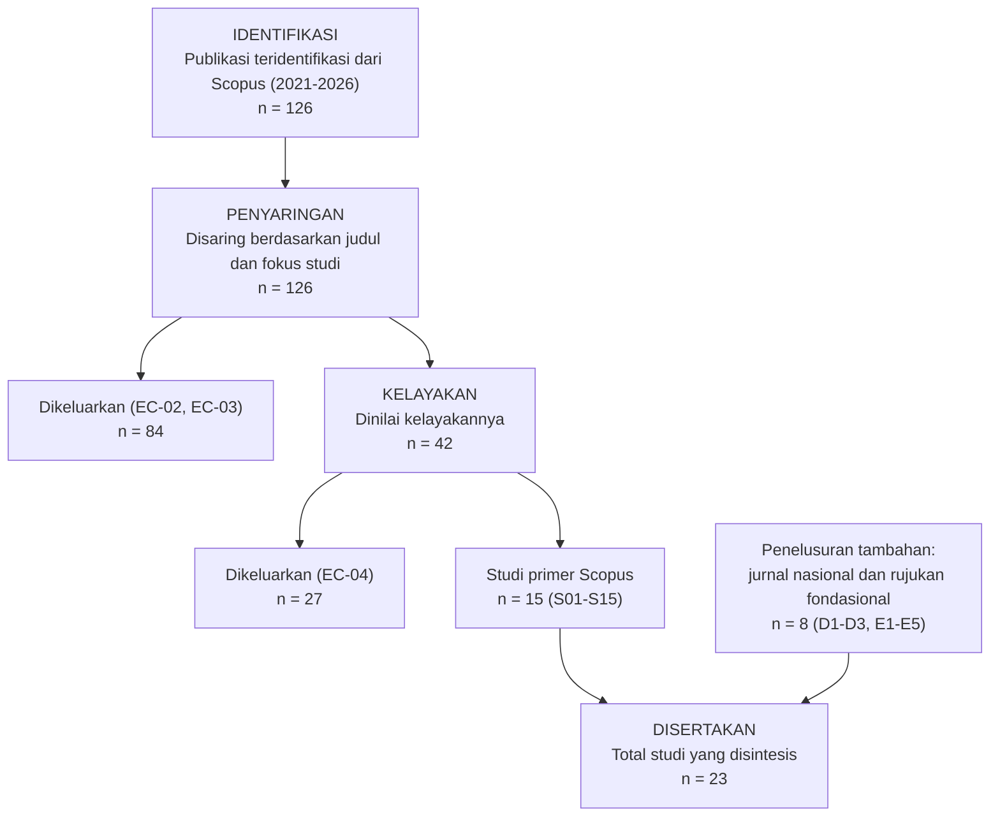

# SYSTEMATIC LITERATURE REVIEW (SLR)
## Protokol PRISMA 2020 untuk Penelitian Asdoku

---

## 1. Research Questions (RQ SLR)

Pertanyaan tinjauan diturunkan dari kerangka PICOS ([Fase 1](../Fase%201%20-%20Ideasi%20&%20PICOS/PICOS_RQ.md)).

| Kode | Pertanyaan tinjauan | Komponen PICOS | Fokus sintesis |
| :--- | :--- | :--- | :--- |
| **SLR-RQ1** | Bagaimana metode NLP, *machine learning*, dan fitur metadata dipakai untuk menganalisis teks tidak terstruktur dan korpus ilmiah? | P, I, S | Algoritma klasik, fitur teks dan fitur tampilan, ketersediaan korpus |
| **SLR-RQ2** | Bagaimana tren arsitektur sistem multi-agen, khususnya pergeseran dari model monolitik ke arsitektur hibrida dengan spesialisasi peran? | I, C | Pembagian peran, kontrol simbolik, syarat sebuah sistem layak disebut multi-agen |
| **SLR-RQ3** | Bagaimana kerangka evaluasi mutu diterapkan pada sistem multi-agen? | C, O | Evaluasi bertingkat, konsistensi penilai, pemilihan metrik |

---

## 2. Search Strategy

### 2.1 Sumber

1. **Scopus**, ditelusuri melalui Scopus AI; laporan tersimpan di [Fase 2](../Fase%202%20-%20Penelusuran%20Literatur%20&%20Evidence%20Matrix/Scopus_AI_Research_Analytics.pdf).
2. **Penelusuran tambahan** pada jurnal nasional (penelitian pemeriksaan format skripsi) dan rujukan fondasional analisis tata letak dokumen, karena kedua topik ini tidak muncul pada hasil Scopus.
3. **Mendeley** untuk mengelola referensi.

### 2.2 Rentang tahun

2021–2026 untuk penelusuran Scopus. Studi tambahan boleh terbit sebelum 2021 bila bersifat fondasional (D1–D3, E1).

### 2.3 Kueri Boolean

```text
(
  "Multi-Agent Systems" OR "Multi-Agent" OR "Agent Collaboration" OR
  "Agentic AI" OR "Role-Specialized Agents"
)
AND
(
  "Natural Language Processing" OR "NLP" OR "Unstructured Text" OR
  "Machine Learning" OR "Scientific Literature Dataset" OR "Metadata-Driven"
)
AND
(
  "Hybrid Architectures" OR "Symbolic Control" OR "Neuro-Symbolic" OR
  "Software Quality Assessment" OR "Multi-Level Evaluation" OR "AI Governance"
)
AND PUBYEAR > 2020 AND PUBYEAR < 2027
```

---

## 3. Inclusion & Exclusion Criteria

| Kode | Kriteria inklusi | Kode | Kriteria eksklusi |
| :--- | :--- | :--- | :--- |
| **IC-01** | Terbit 2021–2026 dan terindeks Scopus. | **EC-01** | Terbit sebelum 2021 (kecuali rujukan fondasional pada penelusuran tambahan). |
| **IC-02** | Membahas integrasi sistem multi-agen dan NLP, termasuk arsitektur hibrida. | **EC-02** | Hanya membahas salah satu bidang tanpa keterkaitan arsitektural. |
| **IC-03** | Membahas algoritma *machine learning* untuk teks, korpus ilmiah, atau agen berbasis peran. | **EC-03** | Aplikasi domain non-dokumen (klinis, pertambangan, geospasial, dan sejenisnya). |
| **IC-04** | Membahas kerangka evaluasi mutu sistem agen. | **EC-04** | *Chatbot* percakapan bebas atau media sosial tanpa kontrol struktur. |

---

## 4. PRISMA Flow Diagram



Diagram ini sama dengan Gambar 2.1 pada draf proposal.

---

## 5. Data Extraction Form

Kolom “Kode” memuat ID SLR dan, dalam kurung, kode baris pada Tabel 2.1 draf proposal. Tanda “—” berarti studi berupa tinjauan atau kajian konseptual tanpa dataset sendiri.

| Kode | Penulis (tahun) | Metode | Dataset | Hasil utama | Limitasi |
| :--- | :--- | :--- | :--- | :--- | :--- |
| S01 (A1) | La Malfa et al. (2025) | Kajian kritis sistem multi-agen berbasis LLM | — | Banyak sistem “multi-agen” tidak memenuhi ciri multi-agen sejati karena desain statis | Tidak memberi rancangan untuk domain dokumen |
| S02 (A2) | Gabauer (2026) | Tinjauan sistematis sistem agen | — | Merekomendasikan arsitektur hibrida dan kerangka evaluasi terpadu | Berfokus pada agen berbasis LLM |
| S03 (A3) | Petridis et al. (2025) | Penilaian konsep agen modern dengan prinsip MAS klasik | — | Otonomi, pembagian peran, dan koordinasi tetap menjadi tolok ukur | Tanpa evaluasi empiris pada domain dokumen |
| S04 (A6) | Kumara et al. (2026) | Metodologi perancangan MAS | — | Panduan komunikasi dan aliran data antar-agen | Panduan umum |
| S05 (B2) | Ali et al. (2024) | Studi komparatif algoritma ML untuk NLP | Beberapa tugas NLP | Algoritma klasik efektif sebagai *baseline* dan pada sumber daya terbatas | Bukan klasifikasi struktur dokumen |
| S06 (B1) | Roldan-Baluis et al. (2022) | Tinjauan sistematis NLP untuk teks tidak terstruktur | — | NLP efektif mengekstraksi struktur dari teks tidak terstruktur | Hanya fitur teks |
| S07 (B3) | Saier et al. (2023) | Pembangunan korpus unarXive | Publikasi arXiv | Korpus teks ilmiah terstruktur skala besar | Bahasa Inggris; bukan .docx |
| S08 (B4) | Li et al. (2022) | Pembangunan korpus CSL | Literatur ilmiah berbahasa Mandarin | Korpus ilmiah non-Inggris untuk tugas NLP | Bukan bahasa Indonesia; bukan label struktur |
| S09 (C1) | Blagec et al. (2022) | Analisis metrik evaluasi NLP | — | Metrik harus sesuai karakteristik tugas dan data | — |
| S10 (A4) | Muwa et al. (2026) | Tinjauan sistematis perencanaan neuro-simbolik | — | Paduan model berbasis data dan penalaran simbolik lebih andal dan dapat dijelaskan | Bukan domain dokumen |
| S11 (A5) | Zhang et al. (2024) | Eksperimen mekanisme kolaborasi agen | Tugas penalaran untuk agen LLM | Spesialisasi peran dan refleksi meningkatkan mutu hasil | Agen berbasis LLM |
| S12 (—) | Latha & Satyanarayan Reddy (2026) | Arsitektur *meta-learning* berbasis metadata | — | Metadata membantu adaptasi model pada tugas baru | Metadata dataset, bukan atribut tata letak dokumen; **tidak dipakai sebagai landasan** |
| S13 (C2) | Chou (2026) | Eksperimen penilai berbasis AI | Evaluasi kode multi-agen | Penilai berbasis LLM tidak konsisten dan peka kompleksitas | Domain evaluasi kode |
| S14 (C3) | Liu, Huang, & Guo (2026) | Kerangka evaluasi MAS bertingkat (Mosaic) | — | Evaluasi MAS perlu bertingkat dan berorientasi proses | Kerangka umum |
| S15 (—) | Agarwal & Nene (2025) | Kerangka tata kelola AI lima lapis | — | Regulasi, standar, dan sertifikasi perlu dipadukan | Tingkat kebijakan publik; **tidak dipakai sebagai landasan** |
| D1 | Tkaczyk et al. (2015) | CERMINE: klasifikasi zona artikel ilmiah | Artikel PDF | Fitur geometris dan tekstual bersama-sama mengenali metadata, isi, dan referensi | Ciri tampilan diestimasi dari PDF |
| D2 | Zhong et al. (2019) | PubLayNet: korpus tata letak | Halaman artikel berlabel otomatis | Label otomatis dari XML memungkinkan korpus besar | Label tidak diverifikasi manusia |
| D3 | Li et al. (2020) | DocBank: anotasi tingkat token, supervisi lemah | Dokumen dari sumber LaTeX | Teks dan tampilan perlu dipadukan | Tingkat token; bukan .docx |
| E1 | Putro (2019) | ML untuk kesesuaian format laporan skripsi | Laporan skripsi | ML dapat mendeteksi kesesuaian format | Hanya mendeteksi |
| E2 | Castrena et al. (2021) | Pencocokan tag XML terhadap aturan template | Dokumen jurnal skripsi | Kesalahan huruf, ukuran, dan margin dilaporkan dalam PDF | Perbaikan manual |
| E3 | Kolinu et al. (2025) | Flask, python-docx, regex (CekNulis) | Naskah skripsi .docx | Mendeteksi kesalahan struktur, format, dan ejaan | Pencocokan string eksak |
| E4 | Aulia & Haviana (2026) | Sistem berbasis aturan; TF-IDF dan *cosine similarity* | Naskah tugas akhir | Akurasi 92,86%; memberi rekomendasi perbaikan | Tidak memperbaiki berkas |
| E5 | Putra et al. (2026) | 44 aturan, 9 kategori; *resolver* pewarisan format OOXML | 17 skripsi; uji injeksi kesalahan | F1 0,985 pada injeksi kesalahan; pelanggaran tersisa pada 15,9% pasangan dokumen–aturan | Memeriksa, tidak memperbaiki |

---

## 6. Synthesis & Thematic Analysis

### 6.1 Tema 1 — Dari model monolitik menuju arsitektur hibrida

Literatur 2021–2026 menunjukkan pergeseran dari sistem yang bertumpu pada satu model menuju sistem kolaboratif yang memadukan penalaran berbasis data dan aturan simbolik (Gabauer, 2026; Muwa et al., 2026). La Malfa et al. (2025) menegaskan bahwa menyusun beberapa pemanggilan model secara berurutan tidak menjadikan sistem multi-agen; pembedanya adalah otonomi tiap agen, pembagian kewenangan, dan interaksi yang mengubah keputusan. Petridis et al. (2025) menambahkan bahwa prinsip MAS klasik tetap menjadi tolok ukur, dan agen tidak harus berbasis LLM.

**Implikasi:** aturan pedoman UEU tidak digantikan model, melainkan ditempatkan sebagai agen tersendiri (Agen 2) yang berwenang mengoreksi model. Agar klaim “multi-agen” dapat diuji, dipakai tiga kriteria operasional: peran dan kewenangan terpisah, umpan balik yang mengubah keputusan agen lain, dan kontribusi kolaborasi yang diukur dengan uji ablasi.

### 6.2 Tema 2 — Algoritma klasik dan fitur tampilan tetap relevan

Ali et al. (2024) menunjukkan algoritma klasik tetap kompetitif untuk klasifikasi teks dengan data terbatas. Penelitian analisis dokumen menunjukkan ciri tampilan (posisi, ukuran huruf, ketebalan) sama pentingnya dengan isi teks (Tkaczyk et al., 2015; Li et al., 2020). Pada .docx, ciri tampilan tidak perlu diestimasi dari piksel karena tersimpan eksplisit di OOXML.

**Implikasi:** model ringan dengan fitur tampilan yang kaya (400 TF-IDF + 37 metadata) lebih sesuai daripada model bahasa besar, terutama karena sistem harus berjalan lokal tanpa mengirim naskah ke pihak ketiga. Kontribusi tiap kelompok fitur tidak diasumsikan, tetapi diuji dengan ablasi fitur.

### 6.3 Tema 3 — Evaluasi yang deterministik dan bertingkat

Chou (2026) menemukan penilai berbasis model generatif tidak konsisten. Liu, Huang, dan Guo (2026) menekankan evaluasi pada setiap tahap interaksi, bukan hanya keluaran akhir. Blagec et al. (2022) mengingatkan bahwa *accuracy* menyesatkan pada data tidak seimbang.

**Implikasi:** pengendali mutu berbasis aturan yang deterministik; dua tingkat evaluasi, yaitu ketepatan deteksi per paragraf (macro-F1 terhadap label manual) dan mutu berkas akhir (kepatuhan kriteria dan keutuhan isi, diperiksa di Microsoft Word).

### 6.4 Tema 4 — Kelangkaan korpus berlabel dan risiko label otomatis

Korpus ilmiah terstruktur didominasi bahasa Inggris dan Mandarin (Saier et al., 2023; Li et al., 2022). Korpus tata letak berskala besar dibangun dengan label otomatis (Zhong et al., 2019; Li et al., 2020), dan supervisi lemah mempercepat pembuatan data latih (Ratner et al., 2017; Liu, Lu, & Mou, 2023). Namun label otomatis membawa derau; bila label yang sama dipakai melatih sekaligus menguji, hasil evaluasi bias.

**Implikasi:** label otomatis hanya diperlakukan sebagai pra-label yang wajib diverifikasi manusia sebelum dipakai untuk evaluasi.

### 6.5 Posisi terhadap penelitian format skripsi di Indonesia

Penelitian klaster E sebagian besar berupa pemeriksa berbasis aturan atau pencocokan string. Sistem tersebut melaporkan kesalahan; perbaikannya manual (Castrena et al., 2021; Kolinu et al., 2025; Aulia & Haviana, 2026; Putra et al., 2026). Pendekatan aturan murni mengandalkan *style* atau pola teks, sehingga kesulitan pada naskah yang judulnya hanya ditebalkan manual. Satu-satunya penelitian yang memakai *machine learning* (Putro, 2019) baru sebatas mendeteksi kesesuaian format.

| Penelitian | Deteksi struktur dengan ML | Aturan pedoman | Perbaikan otomatis .docx | Kolaborasi multi-agen | Label diverifikasi manusia | Uji berkas di Word |
| :--- | :---: | :---: | :---: | :---: | :---: | :---: |
| Putro (2019) | ✓ | – | – | – | – | – |
| Castrena et al. (2021) | – | ✓ | – | – | – | – |
| Kolinu et al. (2025) | – | ✓ | – | – | – | – |
| Aulia & Haviana (2026) | – | ✓ | – | – | – | – |
| Putra et al. (2026) | – | ✓ | – | – | ✓ | – |
| Tkaczyk et al. (2015); Li et al. (2020) | ✓ | – | – | – | sebagian | – |
| Penelitian ini | ✓ | ✓ | ✓ | ✓ | ✓ | ✓ |

---

## 7. Quality Assessment

Setiap studi dinilai oleh peneliti sendiri pada lima indikator, skala 1 (sangat kurang) sampai 5 (sangat baik). Penilaian ini subjektif dan belum diperiksa penilai kedua.

- **QA1** kejelasan masalah dan kontribusi; **QA2** ketepatan metode; **QA3** kejelasan data atau cakupan literatur; **QA4** kekuatan evaluasi; **QA5** relevansi langsung bagi rancangan Asdoku.

| Kode | Studi | QA1 | QA2 | QA3 | QA4 | QA5 | Total (maks. 25) |
| :--- | :--- | :---: | :---: | :---: | :---: | :---: | :---: |
| S01 | La Malfa et al. (2025) | 5 | 5 | 4 | 5 | 5 | 24 |
| S02 | Gabauer (2026) | 5 | 5 | 5 | 5 | 5 | 25 |
| S03 | Petridis et al. (2025) | 5 | 4 | 4 | 4 | 5 | 22 |
| S04 | Kumara et al. (2026) | 5 | 5 | 4 | 4 | 4 | 22 |
| S05 | Ali et al. (2024) | 5 | 5 | 4 | 5 | 4 | 23 |
| S06 | Roldan-Baluis et al. (2022) | 4 | 4 | 4 | 4 | 4 | 20 |
| S07 | Saier et al. (2023) | 5 | 5 | 5 | 4 | 3 | 22 |
| S08 | Li et al. (2022) | 5 | 4 | 5 | 5 | 3 | 22 |
| S09 | Blagec et al. (2022) | 5 | 5 | 4 | 5 | 4 | 23 |
| S10 | Muwa et al. (2026) | 5 | 5 | 4 | 4 | 5 | 23 |
| S11 | Zhang et al. (2024) | 5 | 5 | 4 | 5 | 4 | 23 |
| S12 | Latha & Satyanarayan Reddy (2026) | 4 | 5 | 4 | 4 | 1 | 18 |
| S13 | Chou (2026) | 5 | 5 | 4 | 5 | 4 | 23 |
| S14 | Liu, Huang, & Guo (2026) | 5 | 5 | 5 | 5 | 4 | 24 |
| S15 | Agarwal & Nene (2025) | 5 | 4 | 4 | 4 | 1 | 18 |
| D1 | Tkaczyk et al. (2015) | 5 | 5 | 5 | 5 | 5 | 25 |
| D2 | Zhong et al. (2019) | 5 | 5 | 5 | 5 | 4 | 24 |
| D3 | Li et al. (2020) | 5 | 5 | 5 | 5 | 4 | 24 |
| E1 | Putro (2019) | 4 | 3 | 3 | 3 | 4 | 17 |
| E2 | Castrena et al. (2021) | 4 | 4 | 3 | 3 | 4 | 18 |
| E3 | Kolinu et al. (2025) | 4 | 4 | 3 | 3 | 5 | 19 |
| E4 | Aulia & Haviana (2026) | 4 | 4 | 3 | 4 | 5 | 20 |
| E5 | Putra et al. (2026) | 5 | 5 | 4 | 5 | 5 | 24 |

S12 dan S15 mendapat QA5 = 1 karena tidak relevan langsung, sesuai temuan audit [Fase 6](../Fase%206%20-%20Uji%20Kesesuaian%20&%20Kritik%20Keras/Audit_Kritis_BRD_SLR_Portofolio.md).

---

## 8. Research Gap Matrix

| Jenis gap | Deskripsi gap | Peluang riset (yang dikerjakan penelitian ini) |
| :--- | :--- | :--- |
| **Metodologis** | Belum ada penerapan arsitektur multi-agen hibrida yang sekaligus mendeteksi struktur dan merekonstruksi berkas .docx tanpa menghilangkan isi. Pemeriksa format yang ada berhenti pada pelaporan kesalahan (E1–E5). | Tiga agen dengan peran dan kewenangan terpisah serta dua putaran umpan balik; perbaikan langsung pada berkas. |
| **Dataset** | Belum tersedia korpus naskah tugas akhir berbahasa Indonesia dengan label struktur yang diverifikasi manusia (S07, S08, D2, D3). | Korpus minimal 10 naskah berlabel 9 kelas, diverifikasi manusia, dengan pedoman anotasi dan kappa Cohen. |
| **Konteks** | Pendekatan aturan murni bergantung pada *style* atau pola teks dan kesulitan pada naskah yang judulnya hanya ditebalkan manual; makna paragraf sering bergantung pada konteks dokumen. | Model ML dengan fitur teks + tampilan untuk naskah tanpa *style*, dikoreksi aturan yang memperhitungkan zona dokumen dan urutan bab. |
| **Performa** | Evaluasi sistem sejenis umumnya berhenti pada metrik klasifikasi atau deteksi pelanggaran; belum memeriksa kepatuhan dan keutuhan berkas akhir di aplikasi pengolah kata yang sebenarnya. | Evaluasi dua tingkat: macro-F1 pada naskah uji baru (dengan ablasi dan uji McNemar) serta kepatuhan 8 kriteria, keutuhan isi, dan injeksi cacat, diverifikasi di Microsoft Word. |

Tiga celah penelitian di subbab 2.1.4 draf proposal adalah gabungan baris di atas: celah pertama = Metodologis dan Konteks, celah kedua = Dataset, celah ketiga = Performa.

---

## 9. Kesimpulan & Rekomendasi

### 9.1 Kesimpulan

1. Arsitektur hibrida yang memadukan model berbasis data dengan kontrol aturan, dengan pembagian peran yang jelas, didukung literatur (S01–S04, S10, S11). Literatur yang sama mengingatkan bahwa klaim “multi-agen” harus dibuktikan, bukan hanya dinyatakan.
2. Untuk klasifikasi struktur paragraf, algoritma klasik dengan paduan fitur teks dan tampilan memiliki dasar yang kuat (S05, S06, D1, D3).
3. Evaluasi perlu deterministik, bertingkat, dan memakai metrik yang sesuai data tidak seimbang (S09, S13, S14).
4. Belum ada korpus berlabel untuk naskah tugas akhir berbahasa Indonesia, dan pemeriksa format yang ada belum memperbaiki berkas (S07, S08, D2, E1–E5).

SLR ini **tidak** memuat angka kinerja Asdoku. Angka kinerja baru tersedia setelah evaluasi TA-2.

### 9.2 Rekomendasi

1. **Bab II proposal.** Sudah diselesaikan: proposal menyebut 23 studi dikaji dan 21 studi dimuat di Tabel 2.1, dengan alasan S12 dan S15 tidak dipakai.
2. **Bab IV (TA-2).** Hasil disajikan bertingkat: kinerja Agen 1, kontribusi koreksi Agen 2, lalu kepatuhan dan keutuhan berkas.
3. **Verifikasi rujukan.** Seluruh rujukan dipastikan ada di Mendeley sebelum naskah dikumpulkan; tidak ada sitasi baru tanpa verifikasi.
