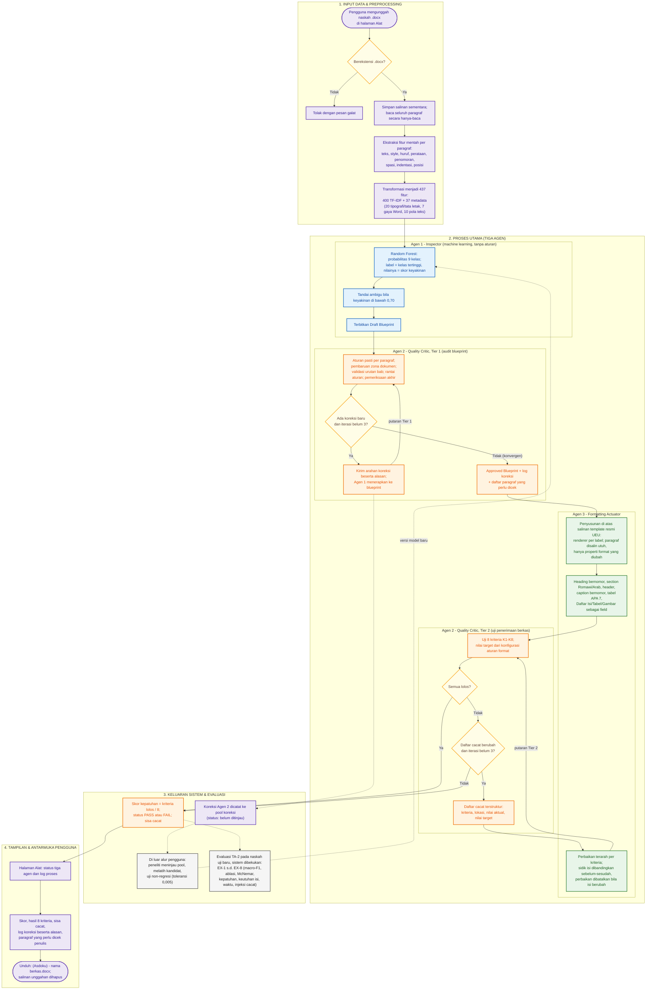
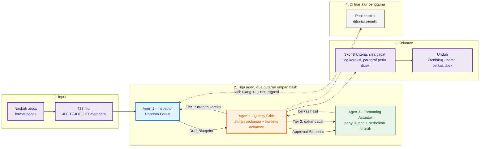

# FASE 7: SPESIFIKASI SISTEM & DIAGRAM ALIR
## Asdoku — Multi-Agent System Berbasis NLP untuk Otomatisasi Deteksi Struktur dan Formatting Dokumen Tugas Akhir

Dokumen ini memuat diagram alir sistem dalam bentuk kode Mermaid dan penjelasan tiap bloknya. Isinya mengikuti rancangan pada Bab III draf proposal (subbab 3.6). Diagram resmi yang dipakai di naskah proposal ada di [Draft_TA/diagram/](../../Draft_TA/diagram/) (22 diagram draw.io); diagram di folder ini adalah ringkasannya.

| Berkas | Isi |
| :--- | :--- |
| `flowchart_vertikal_detail.mmd` | Kode Mermaid alur lengkap (bagian 1 dokumen ini) |
| `flowchart_horizontal_slide.mmd` | Kode Mermaid alur ringkas untuk slide 16:9 (bagian 4) |
| `flowchart_vertikal_detail.drawio` | Salinan Gambar 3.6 draf proposal (Flowchart Cara Kerja Sistem) |
| `flowchart_horizontal_slide.drawio` | Salinan Gambar 3.4 draf proposal (Arsitektur Multi-Agent System) |

Kedua berkas `.drawio` versi lama (420 fitur, pelatihan ulang otomatis) diganti dengan salinan diagram draf proposal agar tidak ada dua versi yang berbeda. Bila diagram di Draft_TA diubah, salin ulang ke folder ini.

---

## 1. Diagram Alir Lengkap (Mermaid)

Diagram memuat empat bagian: masukan dan prapemrosesan, proses utama, keluaran dan evaluasi, serta tampilan pengguna. Warna mengikuti diagram proposal: Agen 1 biru, Agen 2 jingga, Agen 3 hijau, masukan/keluaran ungu, keputusan kuning.



---

## 2. Cara Memakai di Draw.io

1. Buka [app.diagrams.net](https://app.diagrams.net/) atau Draw.io Desktop.
2. Pilih **Arrange → Insert → Advanced → Mermaid**.
3. Tempel isi berkas `.mmd` (tanpa pagar ```` ```mermaid ````), lalu **Insert**.
4. Ekspor lewat **File → Export as → PNG** (300 dpi) atau **SVG**.

Kode Mermaid di dokumen ini belum dicoba dirender; periksa hasilnya di [mermaid.live](https://mermaid.live) sebelum dipakai di slide.

---

## 3. Penjelasan Tiap Blok

### Blok 1 — Masukan dan prapemrosesan

Pengguna mengunggah naskah di halaman Alat; berkas selain .docx ditolak (FR-01). Agen 1 membaca seluruh paragraf secara hanya-baca dan mengekstraksi fitur mentah, lalu mengubahnya menjadi **437 fitur**: 400 TF-IDF (unigram dan bigram) dan 37 metadata, yaitu 20 tipografi dan tata letak OOXML, 7 gaya Word, dan 10 pola teks (FR-02; Tabel 3.11).

### Blok 2 — Proses utama

- **Agen 1 — Inspector.** Random Forest menghasilkan probabilitas sembilan kelas. Paragraf dengan keyakinan di bawah 0,70 ditandai ambigu. Keluarannya *Draft Blueprint* (FR-03, FR-04). Agen ini murni *machine learning*, tanpa aturan buatan, agar kinerjanya dapat diukur terpisah.
- **Agen 2 — Tier 1.** Audit satu kali dari paragraf pertama sampai terakhir dengan mesin status zona dokumen: aturan pasti per paragraf, validasi urutan bab, rantai aturan berprioritas, dan pemeriksaan akhir (Tabel 3.13). Koreksi dikirim ke Agen 1, diterapkan ke *blueprint*, lalu diaudit ulang sampai tidak ada koreksi baru atau tiga iterasi. Keluarannya *Approved Blueprint*, log koreksi beserta alasan, dan daftar paragraf yang perlu dicek penulis (FR-05, FR-06).
- **Agen 3 — penyusunan.** Isi naskah disalin ke salinan template resmi UEU sesuai label, dengan *renderer* per label (Tabel 3.15). Paragraf disalin utuh; hanya properti format yang diubah (FR-07 s.d. FR-11).
- **Agen 2 — Tier 2.** Berkas diuji terhadap 8 kriteria (Tabel 3.14) dengan nilai target dari konfigurasi aturan format. Setiap pelanggaran menjadi satu objek cacat berisi kriteria, lokasi, nilai aktual, dan nilai target (FR-12).
- **Agen 3 — perbaikan terarah.** Untuk setiap cacat dijalankan tindakan perbaikan yang sesuai (Tabel 3.16). Sidik isi dihitung sebelum dan sesudah; bila berbeda, perbaikan dibatalkan. Putaran berhenti bila semua lolos, bila daftar cacat tidak berubah, atau setelah tiga iterasi (FR-13).

### Blok 3 — Keluaran dan evaluasi

- **Keluaran per naskah:** skor kepatuhan (jumlah kriteria lolos dibagi delapan), status PASS atau FAIL, dan sisa cacat.
- **Pool koreksi:** setiap koreksi Agen 2 dicatat berstatus “belum ditinjau” (FR-16). Peneliti meninjau pool, melatih kandidat model, dan menjalankan uji non-regresi dengan toleransi 0,005, semuanya di luar alur pengguna (FR-17). Pengguna tidak diminta memberi label.
- **Evaluasi penelitian:** delapan eksperimen (EX-1 s.d. EX-8) pada naskah uji baru setelah sistem dibekukan. Diagram ini sengaja tidak memuat angka kinerja, karena evaluasi baru dilakukan pada TA-2.

### Blok 4 — Tampilan pengguna

Halaman Alat menampilkan status ketiga agen dan log proses, lalu skor, hasil 8 kriteria, sisa cacat, log koreksi beserta alasan, dan daftar paragraf yang perlu dicek (FR-14). Berkas diunduh dengan nama “(Asdoku) - nama berkas.docx”, dan salinan unggahan dihapus (FR-15).

---

## 4. Diagram Ringkas untuk Slide (16:9)



---

## 5. Padanan dengan Diagram di Proposal

| Yang digambarkan | Gambar di draf proposal |
| :--- | :--- |
| Arsitektur tiga agen | Gambar 3.4 |
| Alur kerja keseluruhan | Gambar 3.6 |
| Agen 1 | Gambar 3.7 |
| Agen 2: zona dokumen, Tier 1, Tier 2 | Gambar 3.8, 3.9, 3.10 |
| Agen 3: penyusunan, perbaikan terarah | Gambar 3.11, 3.12 |
| Urutan pesan antar-agen | Gambar 3.13 |
| Pembelajaran ulang terkendali | Gambar 3.14 |
| Use case, activity, class, ERD | Gambar 3.15 – 3.18 |
| Rancangan antarmuka halaman Alat | Gambar 3.19, 3.20 |
